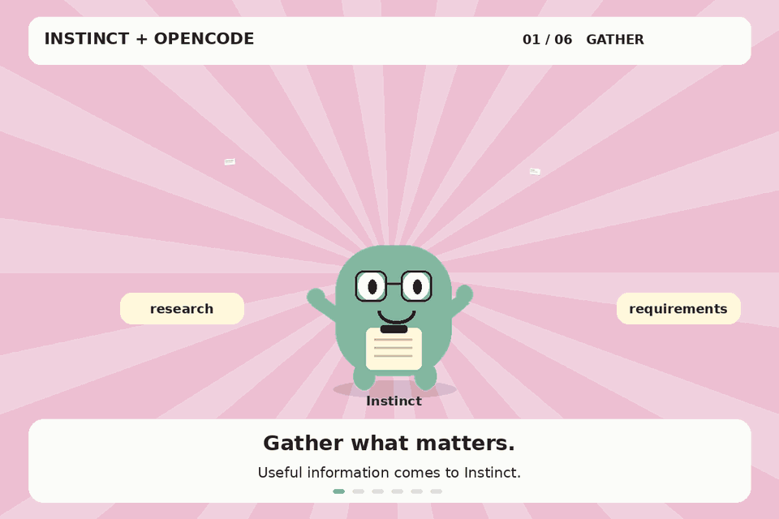

<div align="center">

# 🌉 instinct-bridge <sub><sup>(public source copy)</sup></sub>


**Your machine polls a queue, a supervising AI pushes tasks, and a coding agent does the work — on a per-task git branch.**

Queue transport needs no inbound ports. The daemon also serves a loopback-only HTTP ingress on `127.0.0.1:8787` (see `src/core.js`).

</div>

---

## 🎬 Instinct + OpenCode collaboration



---

##  What you get

| | |
|---|---|
|  **Poll-out, no open ports** | Upstash Redis REST queue (`RPUSH` / `BLPOP`) — nothing to expose. |
|  **One task, one branch** | Each task runs on sanitized `bridge/<task-id>`; tasks run serialized so branches never race. |
|  **Two OpenCode executors** | CLI runner (`opencode run`) or server runner (`opencode serve` on `127.0.0.1:4199`). |
|  **Local review UI** | Loopback ingress (`127.0.0.1:8787`) with task form + results browser, stored in git-ignored `results.jsonl`. |
|  **Honest guardrails** | Branch checks, secret-gated ingress, and clearly labeled soft rules (see below). |

---

##  Requirements

- Node `>=18` (see `engines` in `package.json`)
- `npm install` (installs the `express` dependency)
- `opencode` on `PATH` plus completed `opencode auth login`
- A free Upstash Redis REST URL + token
- `git`

##  Install

```sh
npm install
node bin/bridge.js init    # prompts for Upstash URL/token, tests them, adds repos, writes bridge.config.json (chmod 600)
node bin/bridge.js start  # runs the daemon
```

>  `bridge.config.json` is local-only state created by `init`. **Never commit it.** It holds `upstash_url`, `upstash_token`, `bridge_secret`, optional `openCodeServerPassword` (also accepted via `OPENCODE_SERVER_PASSWORD`), plus `source`, `executor`, `poll_seconds`, `task_timeout_minutes`, `opencode_bin`, `model`, and `repos` (`{name: absolutePath}`). `bridge_secret` is shared with Instinct over a secure link; `openCodeServerPassword` is the password for the user's OpenCode server.

CLI (see `bin/bridge.js`):

```sh
node bin/bridge.js push <repo> "<task>" [session_id]
node bin/bridge.js model [provider/model]   # omit the arg to print the current model
node bin/bridge.js result [secs]
```

## Changing the model from Instinct

Instinct can switch the model the coding agent runs with by publishing a **control task** to the same queue (no new credential or endpoint):

```json
{ "id": "c<unique>", "secret": "<bridge_secret>", "action": "set_model", "model": "opencode/deepseek-v4.1-flash-free" }
```

- The bridge validates the value against the live model list (`GET /api/model`), applies it to the next turn, and **persists it to `bridge.config.json`** so it survives a restart.
- The ack is published to `bridge:results` (and `bridge:status`): `{ "id": "...", "status": "done", "action": "set_model", "model": "opencode/...", "summary": "model set to ..." }`. An unknown model comes back as `status: "error"` with the reason.
- `{ "action": "get_model" }` returns the current model.
- `{ "action": "list_models" }` returns the available `provider/model` strings.
- Locally, `node bin/bridge.js model opencode/deepseek-v4.1-flash-free` does the same.

##  Asking Instinct to do work

Once the daemon is running (`node bin/bridge.js start`), ask Instinct in plain words, naming one of your configured repos and the task. Example: `In repo my-site, add a contact form section to the homepage and verify the page still builds`.

Instinct submits that task through the bridge queue; your machine picks it up, OpenCode does the work on a per-task `bridge/<task-id>` branch, and Instinct returns the result to you.

## Secrets: `bridge_secret` and `openCodeServerPassword`

- `bridge_secret`: generated during `node bin/bridge.js init` and stored only in your local `bridge.config.json` (chmod 600 — never commit it). Enter it once in Instinct's bridge credential setup so Instinct can submit tasks to your bridge. Never paste it into ordinary chat or commit it to Git.
- `openCodeServerPassword`: the password protecting your OpenCode server. Set it in your bridge config (also accepted via `OPENCODE_SERVER_PASSWORD`) so it matches your configured `opencode serve` password. Like `bridge_secret`, keep it out of chat and Git.
- Client integration: send `bridge_secret` in the `X-Bridge-Secret` HTTP header on every authenticated bridge request. Never send it in the URL/query string (to avoid proxy/CDN logs) or in a GET body (which clients/proxies may strip).

---

##  How it works

-  Source adapter (`adapters/source-upstash.js`) uses Upstash REST: `RPUSH bridge:tasks` to enqueue, `BLPOP bridge:tasks` (default 25s) to receive; `RPUSH`/`BLPOP bridge:results` for results. `ping()` uses `PING`.
-  Each task runs on branch `bridge/<task-id>` (sanitized). Tasks run one at a time (serialized in `src/core.js`) so branches and the shared session directory do not race.
-  Executor contract: `run({task, cwd, sessionId, timeoutMs}) -> {sessionId, summary, questions[]}`.
-  Result shape: `{id, status, branch, session_id, open_command, summary, diffstat, questions[]}`. `status` is `done`, `needs_input`, `still_running`, or `error`.
-  `needs_input` (and its `questions[]`) is also carried on the terminal `bridge:status` event, so Instinct can render the question without polling results. When the coding agent asks via an opencode **form**, the bridge relays the form (title + fields) as the question and parks the session: Instinct answers by sending the next task with the **same `session_id`**, and the bridge routes that text through `POST /api/session/:id/form/:formId/reply` before continuing the turn. A question in the final assistant paragraph (a line ending in `?`) is surfaced the same way.
-  OpenCode failures now include the real error: a failed/interrupted turn carries the structured error (`type: message`) in `summary`/`output`, e.g. `OpenCode turn failed (session ...): provider.no-route: Model unavailable: opencode/x`, instead of a bare outcome.
-  Wait exhaustion returns `still_running` with the session ID and `open with: opencode --session <id>`, not a bare timeout. Reconnect with a NEW task id plus that `session_id` for multi-turn work.
-  Local HTTP ingress (`src/core.js`, `127.0.0.1:8787`): `GET /tasks/new` form, `POST /tasks` (secret-gated, rejects duplicate ids), `GET /results`, `POST /results/view`, `GET /results/:id`. Results are appended to `results.jsonl` (local runtime file, git-ignored).

<details>
<summary> Executor details</summary>

- `adapters/executor-opencode.js`: runs `opencode run --auto --format json [--session ...] [--model ...]` in `cwd` with an appended branch rule. `--format json` output is parsed defensively for text and session ID.
- `adapters/executor-opencode-server.js`: uses `opencode serve` on `127.0.0.1:4199` (`POST /api/session`, `POST /api/session/<id>/prompt`, `GET /api/session/<id>/message`). It reuses an already-running server when auth matches. Completion waits for an `idle` message before accepting assistant text. Wait floor is 120 minutes even if `task_timeout_minutes` is smaller; larger `timeoutMs` values are honored. It applies `cfg.model` via `POST /api/session/<id>/model` (and on session create), polls `GET /api/session/<id>/form` to relay questions, and surfaces the structured turn error on failed/interrupted turns. Server startup always sets a password (`openCodeServerPassword` → `OPENCODE_SERVER_PASSWORD` → `bridge_secret` → random) so opencode never self-generates one; a port already held by a server with different credentials fails fast with an actionable message instead of "opencode serve did not come up".

</details>

<details>
<summary> Result statuses</summary>

| Status | Meaning |
|---|---|
| `done` | Work produced output. |
| `needs_input` | The agent is waiting on you: an opencode form (question) is pending, or the last paragraph contains a line ending in `?`. |
| `still_running` | Wait exhausted — reconnect with a NEW task id plus the returned `session_id`. |
| `error` | Something failed (e.g. `HEAD` landed on the wrong branch, or an OpenCode turn failed/interrupted — the structured error is in `summary`/`output`). |

</details>

---

## Guardrails (as implemented)

-  Per-task `bridge_secret` check; unknown repo, missing id/task rejected.
-  After the run, `HEAD` is verified against the task branch; landing on `main`/`master` or another branch marks `error`.
-  The bridge itself never pushes to a remote.
-  The executor prompt rule ("stay on the current branch…") is a soft prompt rule, not a hard guarantee.
-  Secret scrubbing is a `HOOK` placeholder in `src/core.js`, not an implemented sanitizer.
-  Dirty-tree refusal is NOT enforced: the check in `src/core.js` is commented out.

## Permissions

- Command and file permissions are controlled by OpenCode's own `opencode.json`, not by this bridge - the bridge runs whatever the user's OpenCode config allows, and there are no bridge-level prompts.
- Recommended starting example:

```json
{
  "permission": {
    "read": {
      "*": "allow",
      ".env": "deny",
      ".env.*": "deny",
      "*.env": "deny",
      "*.env.*": "deny",
      "*.env.example": "allow"
    },
    "glob": "allow",
    "grep": "allow",
    "list": "allow",
    "edit": {
      "*": "deny",
      "adapters/*": "allow",
      "src/*": "allow",
      "bin/*": "allow",
      "test/*": "allow",
      "LICENSE": "allow",
      "README.md": "allow",
      "package.json": "allow",
      "bridge.config.json": "deny",
      "opencode.json": "deny",
      ".env": "deny",
      ".env.*": "deny",
      "*.env": "deny",
      "*.env.*": "deny",
      "*.log": "deny",
      "results.jsonl": "deny"
    },
    "bash": {
      "*": "ask",
      "git": "allow",
      "git *": "allow",
      "npm": "allow",
      "npm *": "allow",
      "node": "allow",
      "node *": "allow",
      "npx": "allow",
      "npx *": "allow",
      "git push": "deny",
      "git push *": "deny",
      "sudo": "deny",
      "sudo *": "deny",
      "rm -rf *": "deny"
    },
    "external_directory": {
      "*": "deny"
    },
    "webfetch": "ask",
    "websearch": "ask"
  }
}
```

- A full-allow config (`"*": "allow"` everywhere) is an option for users who want zero prompts, and each user picks what fits their risk comfort.

## Verify on your machine

- If summaries or session IDs come back empty, run your opencode command once by hand and adjust the defensive JSON parsing in the executor.
- `needs_input` is a heuristic: the last paragraph contains a line ending in `?`.

---

<div align="center">

<sub>Badges via shields.io · MIT licensed</sub>

</div>
